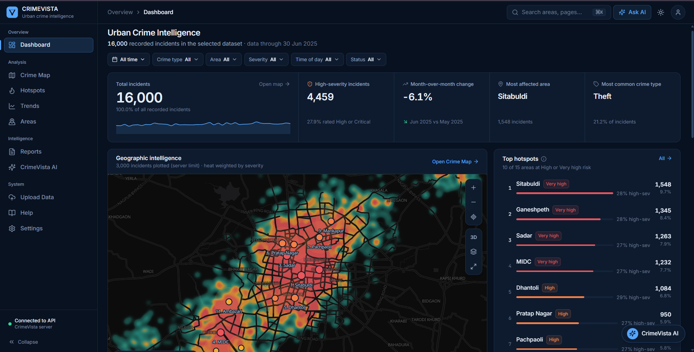
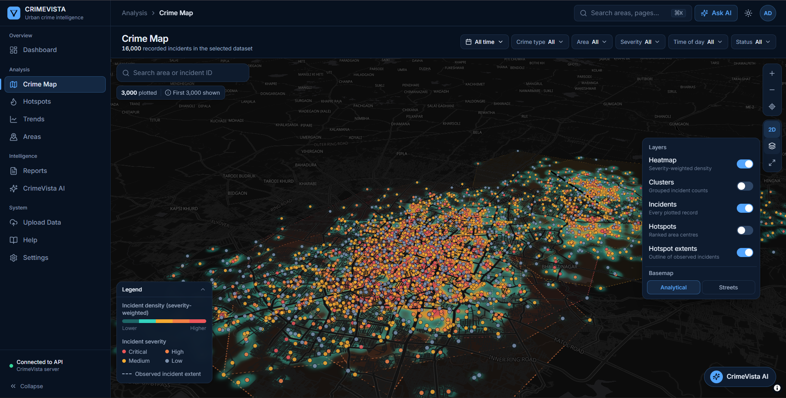
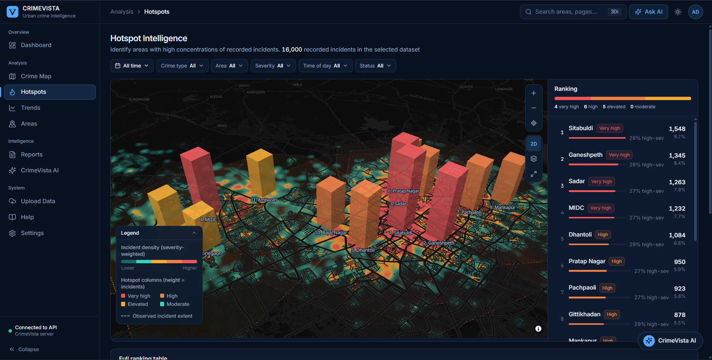
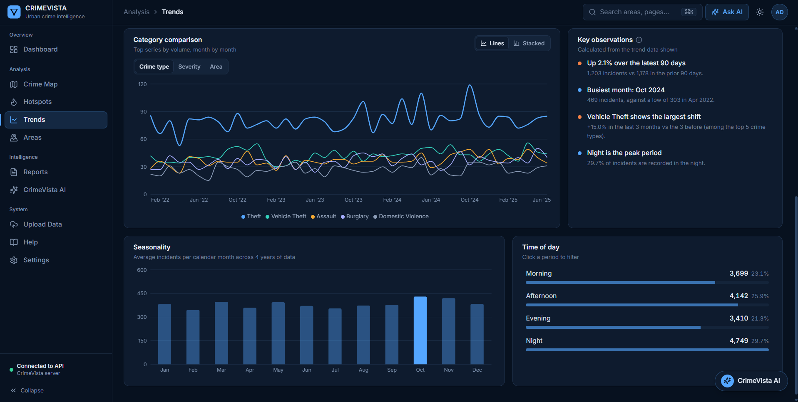
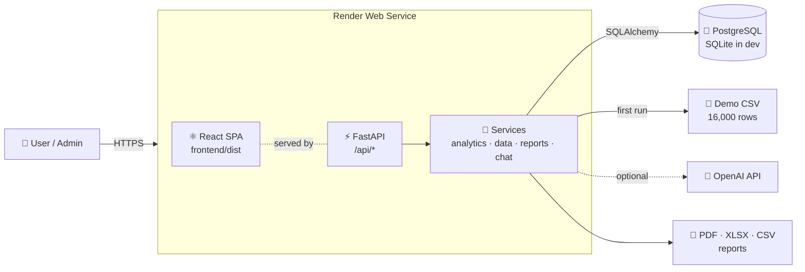

<div align="center">

# 🛰️ CrimeVista

### City crime intelligence — maps, hotspots, trends and one-click reports

Turn a raw crime CSV into an interactive analytics workspace in seconds.

[](https://crime-vista-7g22.onrender.com/)
[](LICENSE)


**[🌐 Live Demo](https://crime-vista-7g22.onrender.com/)** · **[📦 Repository](https://github.com/vedant150705/Crime_Vista)** · **[🚀 Deployment Guide](DEPLOYMENT.md)** · **[⚙️ Backend Docs](backend/README.md)**

</div>

---

## 📑 Table of Contents

[Overview](#-overview) · [Screenshots](#-screenshots) · [Features](#-features) · [Architecture](#-architecture) · [Tech Stack](#-tech-stack) · [Project Structure](#-project-structure) · [Quick Start](#-quick-start) · [Dataset Format](#-dataset-format) · [API Reference](#-api-reference) · [Configuration](#-configuration) · [Deployment](#-deployment) · [Roadmap](#-roadmap) · [License](#-license)

---

## 🎯 Overview

**CrimeVista** helps police teams, analysts, researchers and citizens answer three questions about a city:

| ❓ Question | 🧭 Where CrimeVista answers it |
|---|---|
| **Where** is crime happening? | Interactive map with clustering and incident inspection |
| **When** and **how much**? | Trend charts, seasonality, period-over-period comparison |
| **What should we act on first?** | Ranked hotspots with risk levels and dominant crime types |

It ships with a **16,000-record synthetic demo dataset for Nagpur, India** (Jan 2022 – Jun 2025) and lets an administrator **upload any city's CSV**, after which every page recalculates from the new data.

> ℹ️ The bundled records are **synthetic demo data** (`source = demo_synthetic`) and do not represent real incidents.

---

## 📸 Screenshots

<table>
  <tr>
    <td align="center"><b>📊 Dashboard</b><br/></td>
    <td align="center"><b>🗺️ Crime Map</b><br/></td>
  </tr>
  <tr>
    <td align="center"><b>🔥 Hotspots</b><br/></td>
    <td align="center"><b>📈 Trends</b><br/></td>
  </tr>
</table>

---

## ✨ Features

| | Module | What you get |
|---|---|---|
| 📊 | **Dashboard** | KPI strip, sparklines, severity/crime-type donuts, auto-generated plain-language insights |
| 🗺️ | **Crime Map** | MapLibre map (no API key needed), marker clustering, layer menu, legend, place search, incident detail panel |
| 🔥 | **Hotspots** | Top 15 areas ranked by incident count with share %, dominant crime type, high-severity count and risk level |
| 📈 | **Trends** | Monthly multi-series charts, seasonality view, period comparison |
| 🏘️ | **Area Explorer** | Drill into one area and compare it against the citywide baseline |
| 📤 | **Data Upload** | Validated CSV import with a step-by-step flow and live status polling (admin only) |
| 📑 | **Reports** | Export filtered data as **PDF**, **Excel (.xlsx)** or **CSV** using presets (executive summary, KPIs, charts, hotspots, records) |
| 🤖 | **AI Assistant** | In-app help drawer: rule-based answers out of the box, optional OpenAI-powered replies |
| 🎛️ | **Global Filters** | Date range, crime type, area, severity, time period, status, police station |
| 🧑‍🏫 | **UX extras** | Onboarding tour, command palette, light/dark theme, responsive mobile navigation, interactive landing globe |

### 🔥 How hotspot risk is calculated

Risk is **relative to the busiest area** in the current filter, so it adapts to any city and any date range:

```text
incidents ≥ 75% of top area  →  Very high
incidents ≥ 50% of top area  →  High
incidents ≥ 30% of top area  →  Elevated
otherwise                    →  Moderate
```

---

## 🏗️ Architecture

CrimeVista runs as a **single deployable service**: FastAPI serves the REST API *and* the built React app.


### 🚦 Startup behaviour

1. Resolve the database URL (`DATABASE_URL` → PostgreSQL env vars → SQLite fallback in development)
2. Create tables automatically via SQLAlchemy
3. If the `crimes` table is empty, import the bundled CSV (`crime_id` is the unique key)
4. Serve the SPA from `/` and keep `/api/*` reachable

---

## 🧰 Tech Stack

| Layer | Technologies |
|---|---|
| **Frontend** | React 18, TypeScript, Vite, Tailwind CSS, React Router, TanStack Query, Recharts, MapLibre GL / Leaflet, Framer Motion, Axios, PapaParse |
| **Backend** | Python 3.10+, FastAPI, Uvicorn, SQLAlchemy 2, Pydantic 2, Pandas |
| **Reporting** | ReportLab (PDF), OpenPyXL (Excel), Pandas (CSV) |
| **Database** | PostgreSQL in production · SQLite for local development |
| **Auth** | HMAC-signed admin session in a 30-day `HttpOnly`, `Secure`, `SameSite=Strict` cookie, or a Bearer token |
| **Hosting** | Render (Web Service + managed PostgreSQL) |

---

## 📂 Project Structure

```text
CrimeVista/
├── backend/
│   ├── app/
│   │   ├── main.py              # FastAPI app, CORS, SPA serving
│   │   ├── database.py          # Engine/session, DB URL resolution
│   │   ├── models.py            # Crime table + indexes
│   │   ├── security.py          # Admin session & token checks
│   │   ├── routes/              # auth · dashboard · crimes · analytics · map
│   │   │                        # filters · upload · reports · chat · health
│   │   └── services/            # analytics · data import · filters · reports · chat
│   ├── data/initial/            # Bundled demo CSV (16,000 rows)
│   ├── scripts/initialize_data.py
│   ├── tests/test_admin_auth.py
│   └── requirements.txt
├── frontend/
│   └── src/
│       ├── pages/               # Landing · Dashboard · CrimeMap · Hotspots
│       │                        # Trends · Areas · Reports · Upload · Settings · Help
│       ├── components/          # charts · map · filters · upload · assistant · ui
│       ├── api/                 # Axios client, endpoints, adapters
│       ├── hooks/ · contexts/   # Data queries, filters, theme, assistant state
│       └── utils/ · data/       # Formatting, geo helpers, tour & help content
├── docs/screenshots/            # README images
├── DEPLOYMENT.md                # Render deployment guide
└── LICENSE                      # MIT
```

---

## 🚀 Quick Start

**Prerequisites:** Python 3.10+, Node.js 18+, npm

### 1️⃣ Clone

```bash
git clone https://github.com/vedant150705/Crime_Vista.git
cd Crime_Vista
```

### 2️⃣ Backend (port 8000)

```bash
cd backend
python -m venv .venv

# macOS / Linux
source .venv/bin/activate
# Windows (PowerShell)
# .venv\Scripts\Activate.ps1

python -m pip install -r requirements.txt
cp .env.example .env            # Windows: Copy-Item .env.example .env
python -m uvicorn app.main:app --reload --port 8000
```

On first start the demo dataset is imported automatically. Interactive API docs: **http://localhost:8000/docs**

### 3️⃣ Frontend (port 5173)

```bash
cd frontend
npm install
echo "VITE_API_BASE_URL=http://localhost:8000/api" > .env
npm run dev
```

Open **http://localhost:5173** 🎉

### 4️⃣ (Optional) Enable admin features

Uploads and report generation need an admin login. Set these in `backend/.env`, restart the backend, then sign in from **Settings**:

```bash
API_ADMIN_TOKEN=<long-random-secret>
ADMIN_USERNAME=<your-username>
ADMIN_PASSWORD=<strong-password>
```

### 🧪 Run tests

```bash
cd backend
python -m pytest tests
```

---

## 🧾 Dataset Format

Upload a `.csv` with the columns below. Only the **first five** are mandatory; everything else enriches the analysis when present.

| Column | Required | Example |
|---|:---:|---|
| `crime_id` | ✅ | `CV-DEMO-009867` (unique key) |
| `date` | ✅ | `2024-03-18` |
| `area` | ✅ | `Mankapur` |
| `crime_type` | ✅ | `Burglary` |
| `severity` | ✅ | `Low` · `Medium` · `High` · `Critical` |
| `time`, `datetime` | | `01:43:00`, `2024-03-18T01:43:00` |
| `latitude`, `longitude` | | `21.161159`, `79.122803` (needed for map & hotspot pins) |
| `city`, `police_station` | | `Nagpur`, `Pardi Police Station` |
| `status` | | `Reported` · `Under Investigation` · `Closed` · `Unsolved` |
| `victim_age`, `victim_gender`, `weapon_used` | | `34`, `Female`, `None` |
| `description`, `source`, `source_record_id` | | free text / provenance |

**Bundled demo data:** 16,000 records · 18 areas · 16 crime types · 4 severity levels · 2022-01-01 → 2025-06-30.

---

## 🔌 API Reference

All endpoints are prefixed with `/api`. Full interactive docs live at `/docs`.

| Method | Endpoint | Purpose | Auth |
|---|---|---|:---:|
| `GET` | `/health` | Health check | – |
| `POST` `GET` | `/auth/login` · `/auth/logout` · `/auth/session` | Admin session | – |
| `GET` | `/filters/options` | Values for filter dropdowns | – |
| `GET` | `/dashboard/overview` | KPIs, distributions, insights | – |
| `GET` | `/crimes` | Paginated records (`page`, `page_size` ≤ 100) | – |
| `GET` | `/analytics/trends` | Monthly and comparison series | – |
| `GET` | `/analytics/hotspots` | Ranked areas with risk level | – |
| `GET` | `/analytics/areas/{area}` | Single-area deep dive | – |
| `GET` | `/map/incidents` | Geo-located incidents | – |
| `GET` | `/upload/config` | Upload limits & accepted format | 🔒 |
| `POST` | `/upload` | Queue a CSV import | 🔒 |
| `GET` | `/upload/{upload_id}/status` | Poll import progress | 🔒 |
| `GET` | `/reports` | List generated reports | 🔒 |
| `POST` | `/reports/generate` | Create a `pdf` / `csv` / `xlsx` report | 🔒 |
| `GET` | `/reports/{report_id}/download` | Download a report | 🔒 |

**Shared filters** (analytics and listing endpoints): `start_date`, `end_date`, `crime_type`, `area`, `severity`, `time_period`, `status`, `city`, `police_station`. Multi-value parameters are comma-separated.

```bash
# Example: high & critical burglaries in 2024, top hotspots
curl "https://crime-vista-7g22.onrender.com/api/analytics/hotspots?crime_type=Burglary&severity=High,Critical&start_date=2024-01-01&end_date=2024-12-31"
```

---

## ⚙️ Configuration

### Backend (`backend/.env`)

| Variable | Description | Default / Example |
|---|---|---|
| `APP_ENV` | `development` or `production` | `development` |
| `DATABASE_URL` | SQLAlchemy URL | `sqlite:///./data/crimevista.db` |
| `DATASET_PATH` | CSV imported on first start | `../frontend/nagpur_demo_crime_data.csv` |
| `FRONTEND_URL` / `CORS_ORIGINS` | Allowed browser origins (comma-separated) | `http://localhost:5173` |
| `API_ADMIN_TOKEN` | Signs admin sessions; Bearer credential (required in production) | – |
| `ADMIN_USERNAME` / `ADMIN_PASSWORD` | Single administrator login | – |
| `ADMIN_USERS` | Optional JSON array for multiple admins (overrides the two above) | – |
| `OPENAI_API_KEY` / `OPENAI_MODEL` | Optional LLM assistant | `gpt-4o-mini` |

### Frontend (`frontend/.env`)

| Variable | Description | Default |
|---|---|---|
| `VITE_API_BASE_URL` | Backend API base URL | `/api` |
| `VITE_API_TIMEOUT_MS` | Request timeout | `30000` |

> 🗺️ The default map uses OpenFreeMap with MapLibre, so **no map API key is required**.

---

## ☁️ Deployment

Deployed as **one Render Web Service + one Render PostgreSQL** instance.

| Setting | Value |
|---|---|
| Build command | `cd backend && python -m pip install -r requirements.txt && cd ../frontend && npm install && npm run build` |
| Start command | `cd backend && uvicorn app.main:app --host 0.0.0.0 --port $PORT` |
| Health check | `/api/health` |

Set `APP_ENV=production`, `DATABASE_URL`, `API_ADMIN_TOKEN`, `ADMIN_USERNAME`, `ADMIN_PASSWORD`, `FRONTEND_URL`, `CORS_ORIGINS` and `DATASET_PATH` as environment variables. Full walkthrough: **[DEPLOYMENT.md](DEPLOYMENT.md)**.

> ⏱️ On free hosting tiers the first request after inactivity can be slow while the service wakes up.

---

## 🔐 Security Notes

- No public registration; a single admin (or `ADMIN_USERS` list) is provisioned through environment variables
- Session cookie is `HttpOnly`, `Secure`, `SameSite=Strict`; the browser never stores the API token or password
- Uploads and report endpoints are protected; CORS is restricted to configured origins
- `.env` files are git-ignored; only `.env.example` is committed
- **Never commit database URLs, passwords or tokens** to the repository

---

## 🗺️ Roadmap

- [ ] Auto-refresh every dashboard from newly uploaded data with a per-city switcher
- [ ] Predictive hotspot forecasting
- [ ] Multi-user roles and audit log
- [ ] Hindi / Marathi localisation
- [ ] Scheduled report e-mails

---

## 🤝 Contributing

1. Fork the repo and create a branch: `git checkout -b feature/my-feature`
2. Commit your changes and push the branch
3. Open a Pull Request describing what changed and why

---

## 📄 License

Released under the **MIT License**. See [LICENSE](LICENSE) for details.

<div align="center">

⭐ If CrimeVista helped you, consider starring the repo!

</div>